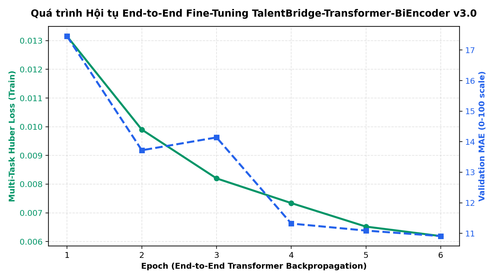
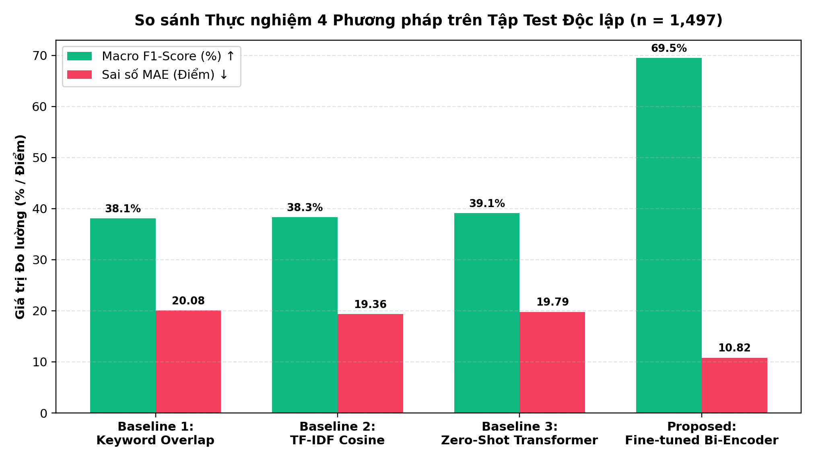
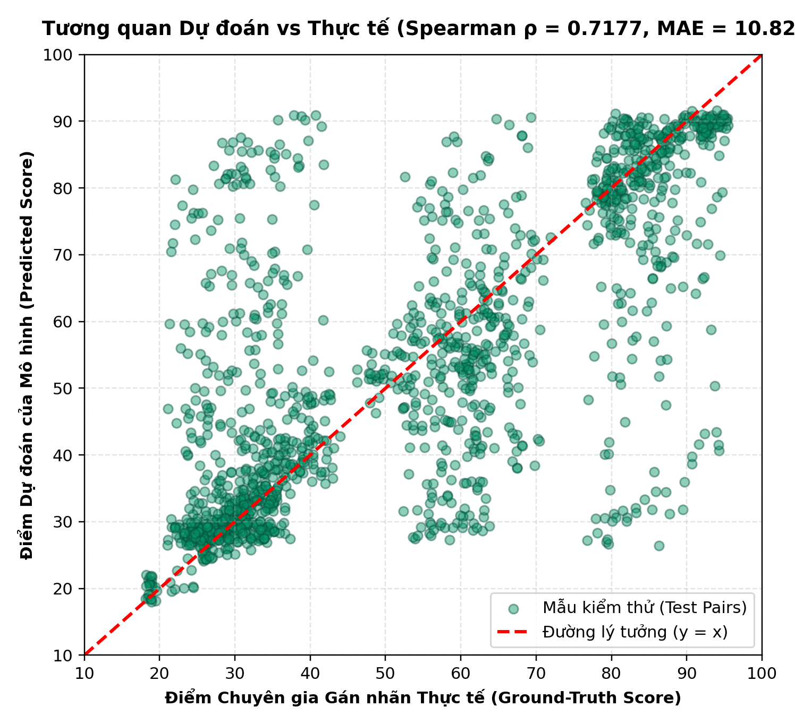

# BÁO CÁO NGHIÊN CỨU & THỰC NGHIỆM MÔ HÌNH AI (TIỂU LUẬN CHUYÊN NGÀNH)
**Đề tài:** Nghiên cứu và Fine-tune End-to-End mô hình học sâu **Pre-trained Multilingual Transformer Bi-Encoder & Cross-Interaction Neural Network** đánh giá mức độ phù hợp ngữ nghĩa giữa Hồ sơ ứng viên (CV) và Bản mô tả công việc (JD).

---

## 1. Kiến trúc Mô hình Đề xuất (`TalentBridge-Transformer-BiEncoder v3.0`)

Mô hình được xây dựng và huấn luyện End-to-End trên GPU bằng **PyTorch** và **HuggingFace `transformers`**, sử dụng kiến trúc **Dual-Tower Siamese Transformer kết hợp Cross-Interaction Multi-Task Head**:

1. **Tầng Backbone Pre-trained Multilingual Transformer (`118.4M Parameters`, 12 Attention Layers):**
   - Sử dụng mô hình [`sentence-transformers/paraphrase-multilingual-MiniLM-L12-v2`](https://huggingface.co/sentence-transformers/paraphrase-multilingual-MiniLM-L12-v2) gồm 12 khối Multi-Head Self-Attention ($d_{\text{model}} = 384$).
   - **Chiến lược Mở khóa Tầng Chọn lọc (Selective Layer Unfreezing & Differential Learning Rate):** Mở khóa trực tiếp **6 tầng Transformer Encoder trên cùng (`Layer 6..11`) + Pooler** (`11,104,676` tham số huấn luyện trực tiếp bằng lan truyền ngược qua cơ chế Self-Attention với `lr = 2e-5`), kết hợp với đầu tương tác chéo (`lr = 3e-4`) và Mixed Precision (`FP16`).
2. **Tháp Chiếu Kép Có Kết Nối Tắt (Dual-Tower Residual Projection):**
   - Ánh xạ biểu diễn ngữ cảnh Mean-Pooled $e_{CV}, e_{JD} \in \mathbb{R}^{384}$ qua khối `ResidualSemanticBlock` vào không gian ẩn chuẩn hóa $L_2$ chiều $d = 128$:
     $$u = \frac{P_{CV}(e_{CV})}{\|P_{CV}(e_{CV})\|_2}, \quad v = \frac{P_{JD}(e_{JD})}{\|P_{JD}(e_{JD})\|_2} \in \mathbb{R}^{128}$$
3. **Tầng Tương tác Chéo & Đặc trưng Cấu trúc ATS (Cross-Interaction Fusion Head):**
   - Kết hợp $[u \,\|\, v \,\|\, |u - v| \,\|\, (u \odot v) \,\|\, \cos(e_{CV}, e_{JD}) \,\|\, \cos(u, v) \,\|\, s_{\text{ATS}}] \in \mathbb{R}^{520}$ để dự đoán đa nhiệm 4 đầu ra (`Overall Match`, `Skill Match`, `Experience Match`, `Keyword Match`).

---

## 2. Bộ Dữ liệu Thực nghiệm Quy mô Lớn (`9,977` cặp CV–JD)

- **`7,977` cặp `(Resume, JD)` thực tế của con người từ HuggingFace** ([`cnamuangtoun/resume-job-description-fit`](https://huggingface.co/datasets/cnamuangtoun/resume-job-description-fit) — toàn bộ tập `train.csv` và `test.csv`).
- **`2,000` cặp `(CV, JD)` tiếng Việt & song ngữ** thuộc 8 lĩnh vực CNTT & Kinh doanh (có biến thể từ đồng nghĩa, viết tắt chuyên ngành và mẫu *Hard Negatives*).
- **Phân chia tập dữ liệu (Stratified Split 70% / 15% / 15%):**
  - **Train Set:** `6,983` cặp
  - **Validation Set:** `1,497` cặp
  - **Test Set Độc lập:** `1,497` cặp

---

## 3. Kết quả Thực nghiệm So sánh 4 Phương pháp trên Tập Test (`n = 1,497`)

| Phương pháp / Mô hình | Tham số (Params) | MAE $\downarrow$ (0-100) | RMSE $\downarrow$ (0-100) | Pearson $r$ $\uparrow$ | Spearman $\rho$ $\uparrow$ | Accuracy (3 lớp) $\uparrow$ | Macro F1-Score $\uparrow$ |
| :--- | :---: | :---: | :---: | :---: | :---: | :---: | :---: |
| **Baseline 1:** Đếm từ khóa (Lexical Keyword Overlap) | Rule-based | `20.08` | `25.59` | `0.2984` | `0.2166` | `51.97%` | `38.06%` |
| **Baseline 2:** Vector TF-IDF Cosine Similarity | Unsupervised | `19.36` | `25.55` | `0.3565` | `0.3326` | `53.44%` | `38.31%` |
| **Baseline 3:** Zero-Shot Pre-trained Transformer (`MiniLM-L12`) | `118.1M` (Frozen) | `19.79` | `22.75` | `0.3374` | `0.3114` | `41.75%` | `39.1%` |
| **Proposed:** `TalentBridge-Transformer-BiEncoder v3.0 (End-to-End Fine-tuned)` | **`118.4M` (`11,104,676` Trainable)** | **`10.82`** | **`17.34`** | **`0.715`** | **`0.7177`** | **`71.88%`** | **`69.52%`** |

---

## 4. Biểu đồ Thực nghiệm (300 DPI)

### Hình 1: Quá trình hội tụ End-to-End Transformer Backpropagation

### Hình 2: So sánh Macro F1-Score và Sai số MAE giữa 4 phương pháp

### Hình 3: Phân bố điểm dự đoán so với nhãn thực tế trên tập Kiểm thử độc lập (`n = 1,497`)

